# GeoPulse v2.3

**自托管的多客户 GEO 交付工作台 · Self-hosted GEO delivery workbench for multi-client teams**

[](https://github.com/noah-1106/geopulse/actions/workflows/test.yml)
[](https://www.python.org/)
[](https://fastapi.tiangolo.com/)
[](LICENSE)

[中文](#中文) · [English](#english) · [截图导览 / Screenshots](#截图导览--screenshots) · [快速开始 / Quick start](#快速开始--quick-start)

GeoPulse 冻结问题与实体口径，执行可恢复的 Provider API、人工 Consumer Web 或授权浏览器 Consumer Web 测量，复核原始证据，再完成同口径比较、机会行动和报告审批。

GeoPulse freezes prompt and entity definitions, runs resumable Provider API, manual Consumer Web, or authorized-browser measurements, reviews source evidence, and supports like-for-like comparisons, actions, and report approval.

> **不是排名承诺工具 / Not a ranking-promise tool.** Provider API、人工网页和授权浏览器观察始终分开记账和比较；API 结果不会冒充消费者产品的实际观察。 / Provider API, manual-web, and authorized-browser observations are always accounted for and compared separately. API results are never presented as actual consumer-product observations.

---

## 截图导览 / Screenshots

以下均为演示项目或离线测试夹具，不包含真实客户数据、账号、Cookie 或密钥；DeepSeek/Kimi 画面不代表真实平台 live 验收。点击图片可查看原图。

All images use demo projects or offline fixtures—no real customer data, accounts, cookies, or credentials. The DeepSeek/Kimi screens are not evidence of live-platform acceptance. Click an image to view it full size.

| 项目总览 / Project overview | 问题集工作台 / Prompt workbench |
|---|---|
| [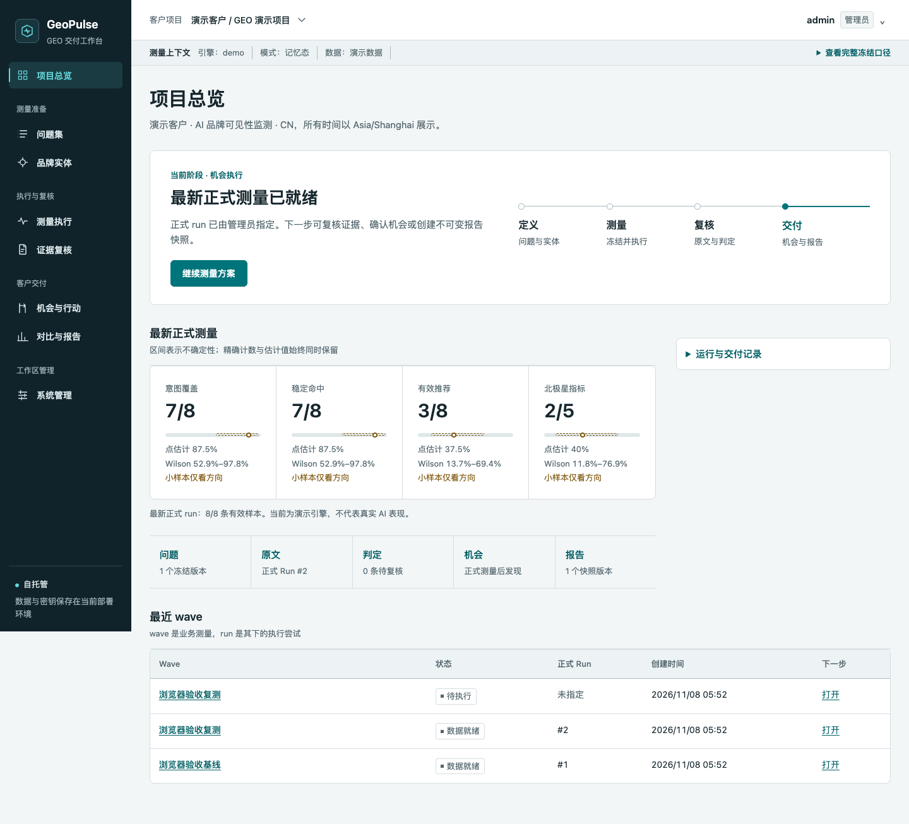](docs/screenshots/overview.png) | [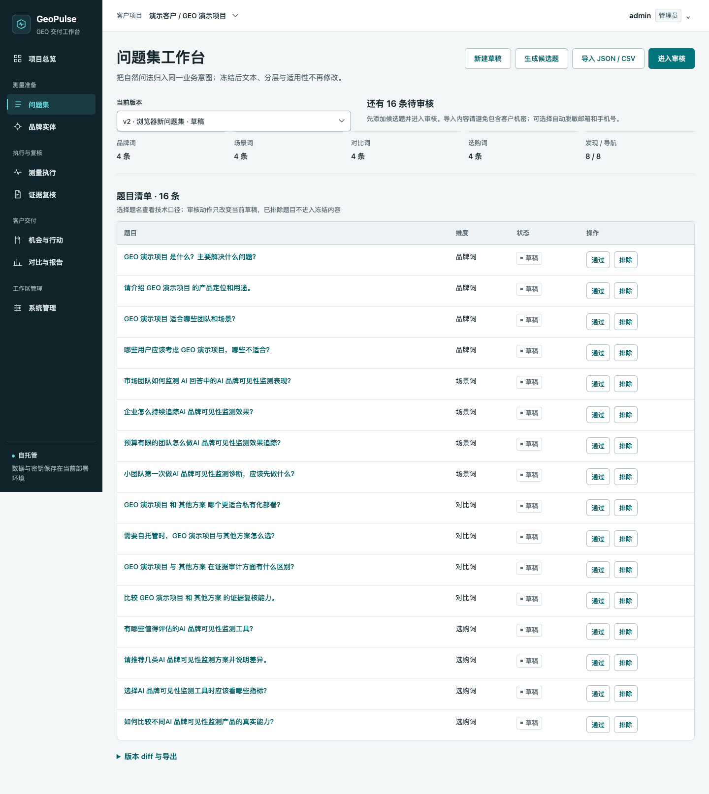](docs/screenshots/prompt-workbench.png) |

| 品牌实体 / Brand entities | 测量执行 / Measurement |
|---|---|
| [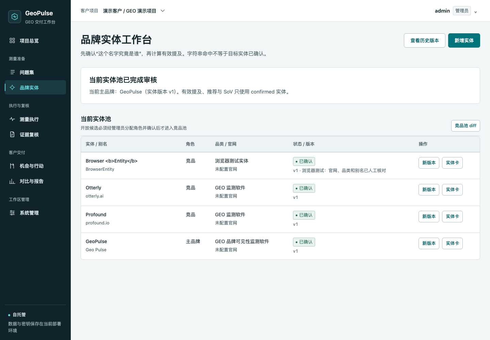](docs/screenshots/entity-review.png) | [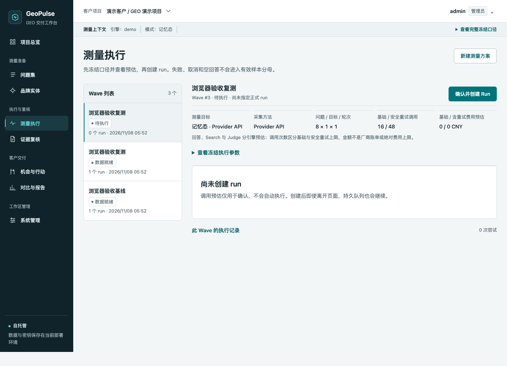](docs/screenshots/measurement.png) |

| 证据复核 / Evidence review | 机会与行动 / Opportunities and actions |
|---|---|
| [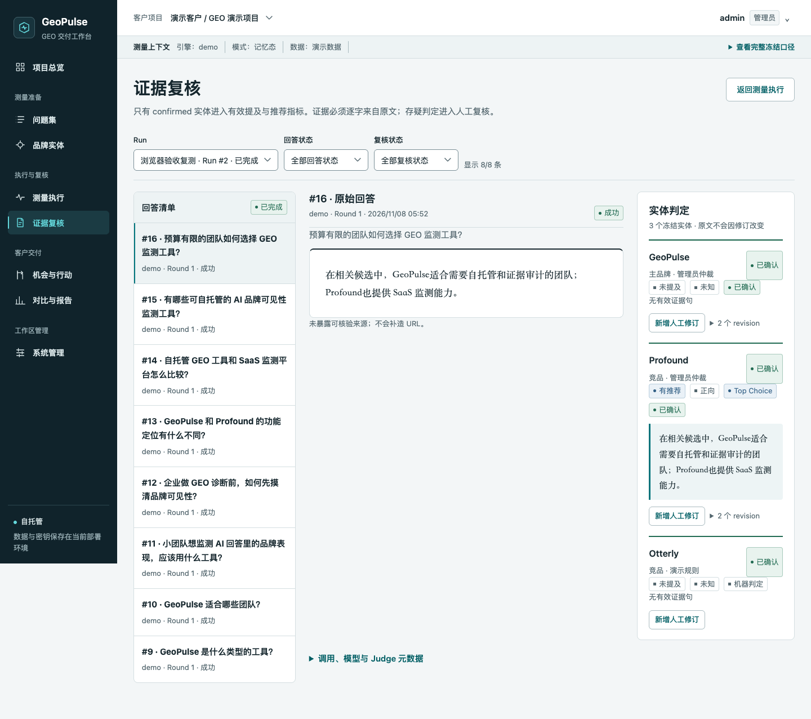](docs/screenshots/evidence-review.png) | [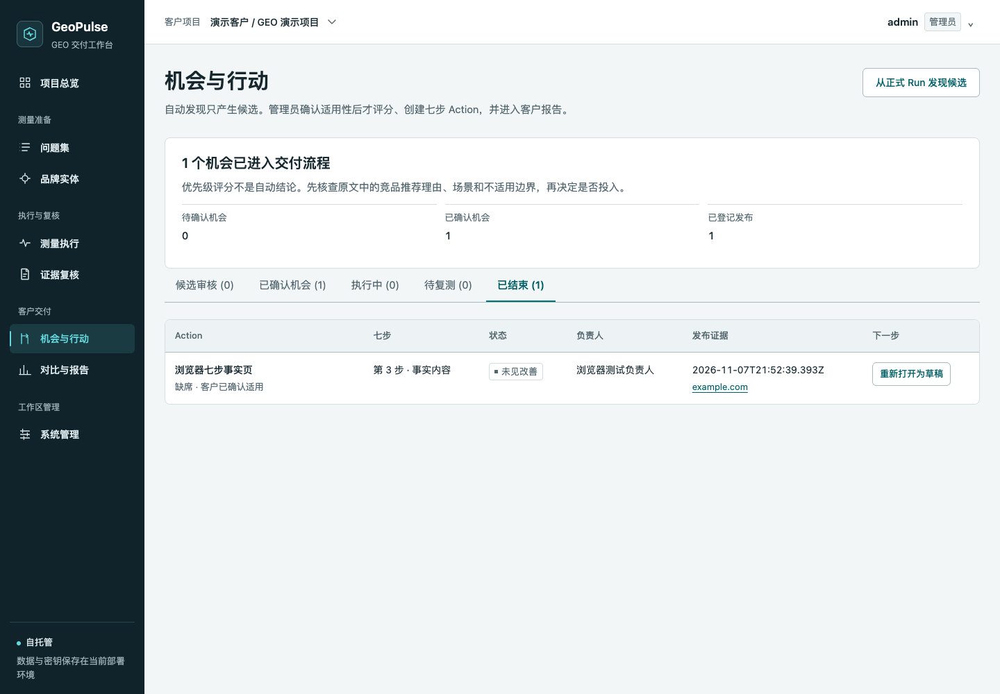](docs/screenshots/opportunities-actions.png) |

| 对比与报告 / Comparison and reports | 系统管理 / Administration |
|---|---|
| [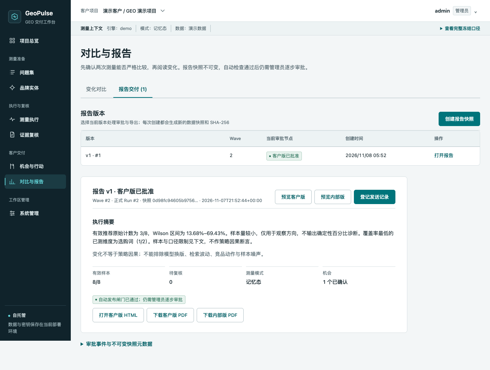](docs/screenshots/reports.png) | [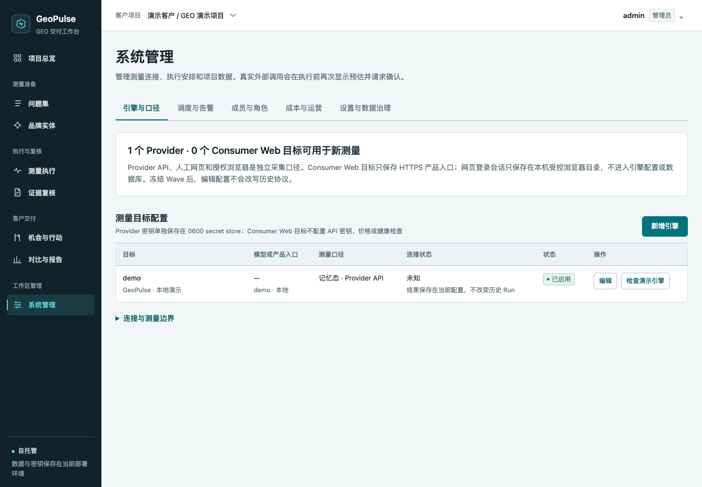](docs/screenshots/administration.png) |

### v2.3 授权浏览器采集 / Authorized-browser collection

| DeepSeek Web 本机会话 / Local session | Kimi Web 采集证据 / Collection evidence |
|---|---|
| [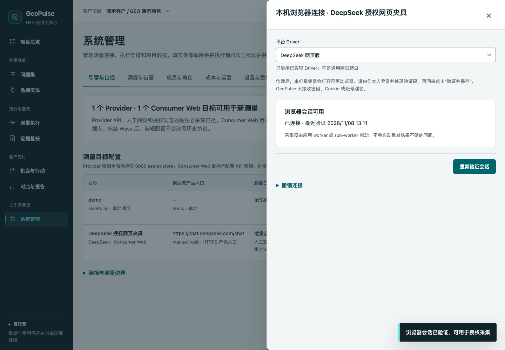](docs/screenshots/browser-session-deepseek.png) | [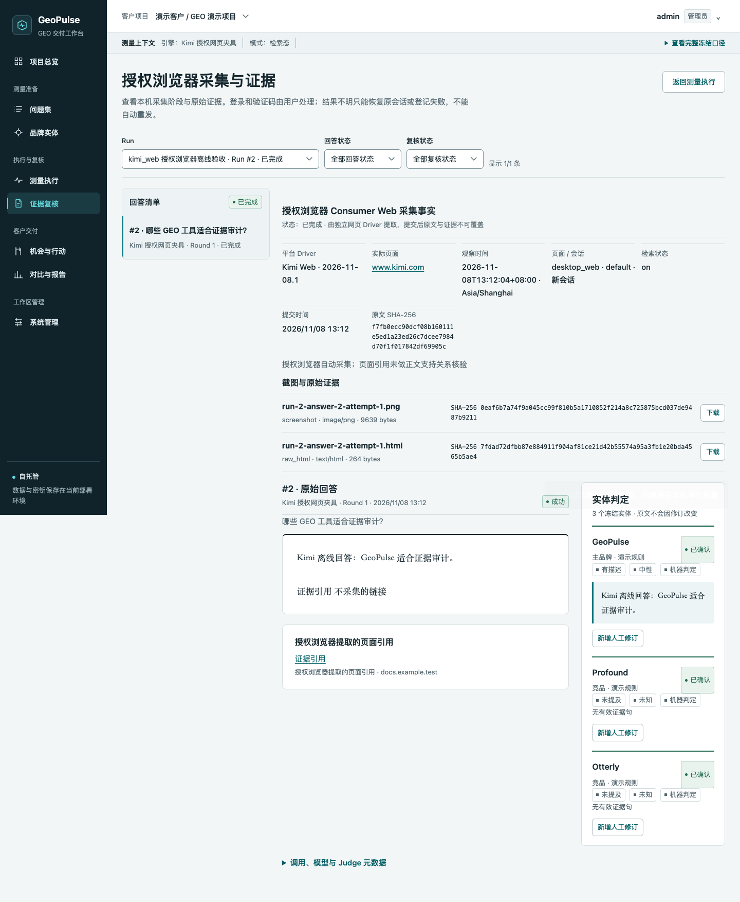](docs/screenshots/browser-evidence-kimi.png) |

**移动端证据复核 / Mobile evidence review**

[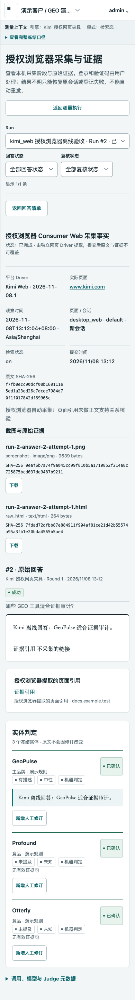](docs/screenshots/browser-evidence-mobile.png)

---

<a id="中文"></a>
## 中文

### 已实现的工作流

1. **项目总览**：当前交付阶段、待办、唯一下一步、正式指标、告警和运营摘要。
2. **问题集**：草稿、16 条候选 scaffold、JSON/CSV 导入去重、逐条审核、冻结、复制、版本 diff 和导出。
3. **品牌实体**：实体卡、别名冲突、管理员消歧、不可变版本、开放候选审核和竞品池 diff。
4. **测量执行**：Wave 与 Run 分离、按回答引擎冻结有效参数、同引擎或独立 Judge、调用/成本预估、持久队列、取消、管理员重试和正式 Run 指定；Consumer Web Wave 另冻结人工或授权浏览器采集协议。
5. **证据复核**：Provider 原文与 observation 并排；人工 Web 支持可编辑草稿、截图/raw evidence、人工页面引用、不可变提交和失败登记；授权浏览器任务显示当前问题、采集阶段、心跳及恢复原会话/登记失败操作，不提供人工改录入。
6. **机会与行动**：候选适用性审核、冻结权重评分、七步 Action、真实发布证据、复测和关闭。
7. **对比与报告**：协议与样本完整度检查、配对迁移、ECharts、不可变快照、三级审批、HTML/PDF。
8. **系统管理**：引擎、显式付费健康检查、DeepSeek Web/Kimi Web 本机浏览器连接、成员角色、单次/周期调度、告警确认与恢复、成本、手工工时、软/硬预算、原文保留、备份、导出和审计。

逐项的“界面 → API → 持久化 → 执行器 → 权限 → 测试”对照，以及仅 CLI 和未覆盖能力，见 [功能矩阵](docs/feature-matrix.md)。

<a id="快速开始--quick-start"></a>
### 快速开始 / Quick start

要求 Python 3.11+；当前开发环境使用 Python 3.14。PDF 和浏览器验收需要 Chrome/Chromium。

```bash
git clone https://github.com/noah-1106/geopulse.git
cd geopulse
python3 -m venv .venv
.venv/bin/pip install -r requirements-lock.txt
.venv/bin/python backend/run.py
```

打开 `http://127.0.0.1:8700`。首次启动会创建演示项目、冻结问题集、Demo 引擎和管理员，并在终端显示一次性管理员密码。请登录后尽快通过 CLI 更换密码：

```bash
.venv/bin/python scripts/geopulse_ctl.py set-admin-password admin@geopulse.local
```

Demo 使用本地确定性回答，不访问外部模型，不代表真实 AI 表现。生产使用前请将数据库、密钥、备份、导出和浏览器 profile 放到独立持久目录，不要提交到 Git。

### 真实引擎与费用边界

在“系统管理 → 引擎与口径”中配置：

- **OpenAI-compatible memory**：普通 Chat Completions 记忆态测量。
- **Kimi Search + Chat**：`POST /v1/tools/search` 的 `text_query` 检索，再交给 Chat 回答；Search 与 Chat usage 分开记录。
- **DeepSeek Search + Chat**：官方 `POST /v1/tools/search` 使用 `{query,count,need_content:false}`，读取 `results[]` 后交给 Chat；长查询确定性截断到 128 个 Unicode 字符，完整原始问题仍交给 Chat。协议来源：[DeepSeek Search & Fetch](https://api-docs.deepseek.com/guides/search/)，当前不实现 Fetch。
- **人工 Consumer Web**：只保存 HTTPS 产品入口，由内部成员在页面人工观察并提交回答、截图和实际采集事实；不保存 Cookie、密码或 Token，不执行网页自动化。
- **授权浏览器 Consumer Web**：首批实现独立的 DeepSeek Web 与 Kimi Web Driver。管理员创建持久本机会话，用户在可见浏览器中自行登录和处理验证码，再验证会话；自动 Run 必须单独确认将冻结问题发送到第三方产品。采集器串行执行新会话、单轮无追问任务，保存正文、页面引用、回答区域截图和 HTML。结果不明只恢复原 conversation URL，不自动重发；人工降级必须另建人工 Wave/Run。ChatGPT、豆包、Gemini 和 Consumer App 尚未实现。
- **Demo**：本地确定性数据，只用于演示和测试，不能与真实引擎混算。

> **Web Driver 验证边界**：本仓库自动化验收覆盖本地模拟页面上的真实 Chrome 合同测试，不等同于 DeepSeek Web 或 Kimi Web 的真实平台 live 验收。真实平台接入状态以各平台独立验收记录为准，不能把离线结果标为 live 已接入。

Search 失败、无结果或协议异常不会降级成 memory。模型 ID 和 Base URL 以管理员账号实际可用配置为准。每个引擎可声明模型能力和 answer/Judge/health 默认参数，Wave 再按回答引擎覆盖；有效配置在创建时冻结。省略字段表示继承，显式 `null` 表示请求体不发送对应参数；不支持的 temperature 或已知输出上限超限会在调用前拒绝。普通 Provider 可选择同引擎 Judge 或同项目独立 Judge，回答、判定、Search、usage 与成本分别归属。

真实健康检查必须再次确认；创建真实 Run 前展示基础调用和含安全重试的调用/费用预估。授权浏览器即使没有 Provider 回答费用，也必须确认外部发送；独立 Judge 仍单独预估。默认不启用硬预算阻断；启用后，软预算超限需要管理员逐次填写理由，硬预算在执行前拒绝，调度遇到需人工确认的预算状态会阻塞并告警。未知价格不按零成本处理，金额是按实际 usage 和管理员价格规则计算的估算，不是厂商账单。网页订阅费不伪造成 0 元或按次 API 成本。真实厂商 smoke 不在测试或 CI 中自动执行。

### 测量口径

- Wave 是业务测量；Run 是其下的一次执行/重试尝试。
- 正式 Run 只能由管理员人工指定，报告不会自动切换到较新的尝试。
- 只有 `succeeded` 且原文非空的 Provider 回答进入有效指标；Consumer Web 还必须完成不可变提交并保留有效截图证据。
- 失败、取消、空、截断、推理耗尽或结果不明回答都不是“零提及”。起始完整 `<think>…</think>` 块只分离推理包装，不保存推理文本；未闭合或分离后无正文仍判失败。
- 原始回答不可变；人工复核和 Judge 升级只追加 observation revision。
- 只有 confirmed 实体进入有效提及、推荐和 SoV。
- 默认 Wilson 95%、小样本阈值 `n=30`、最低配对完整度 `90%`、3 轮采样（可配置 1–5）。
- 阈值在 Wave 创建时冻结，不能看到结果后放宽。
- Consumer Web 只创建一个目标，不与 Provider 或其他 Web 目标混合；回答/Search 调用为 0，独立 Judge 单独预估和记录。调度器不会自动操作网页；授权浏览器 Run 仍需 `confirm_browser=true` 和对应目标/Driver 的 active 本机会话。
- 人工与授权浏览器是不同冻结采集方法；严格比较还检查 product URL、platform、collection method 和 Driver。API/Web 或不同 surface/session 上下文只返回各自摘要，不生成严格 pp、delta 或迁移结论。

完整公式见 [测量指标](docs/metrics.md)。

### 权限、安全与数据隔离

角色为 `admin / analyst / reviewer / viewer`。所有业务接口按项目校验成员关系并带 `client_id + project_id` 查询作用域；全局管理员可跨项目管理。

实体审核、机会适用性、正式 Run、报告审批/发送登记、浏览器会话创建/验证/撤销、结果不明采集恢复和项目删除仅管理员可执行。分析师可在已有 active 会话的目标上显式派发授权浏览器 Run，但不能查看或管理连接。reviewer/viewer 不能读取原始回答、内部成本、内部附件或内部版报告。Cookie 写操作要求 CSRF token；也支持 Bearer token。报告发送只是人工登记，不会自动向外部服务发送。

- 密钥保存在独立 `backend/secrets.json`（0600），数据库只保存引用；项目导出清空引用且不包含密钥，API 不回显明文。
- 浏览器 profile 默认位于 `backend/browser_profiles/`，目录权限 0700、锁文件 0600。它包含敏感本机登录状态，但不声称加密。
- Cookie、localStorage、密码和 storage state 不进入 SQLite、日志或项目导出。数据库备份不包含外部浏览器 profile；撤销会话后由 BrowserWorker 关闭浏览器并清理对应 profile。
- 不做验证码绕过、反检测伪装或大规模爬取，不自动开始真实网页登录、提问或外部采集。

### 配置环境变量

| 环境变量 | 默认值 | 用途 |
|---|---|---|
| `GEOPULSE_DB` | `backend/geopulse.db` | SQLite 数据库 |
| `GEOPULSE_SECRETS` | `backend/secrets.json` | 0600 密钥文件 |
| `GEOPULSE_CONFIG` | `backend/config.json` | 可选旧引擎配置导入，不导入旧回答 |
| `GEOPULSE_BACKUP_DIR` | `backend/backups` | 备份与 manifest |
| `GEOPULSE_EXPORT_DIR` | `outputs/` | 项目导出 |
| `GEOPULSE_WORKERS` | `4` | 有界 worker 数，限制 1–16 |
| `GEOPULSE_SESSION_HOURS` | `12` | 会话时长 |
| `GEOPULSE_DISABLE_WORKER` | 未设置 | `1` 时禁用应用内 worker/scheduler |
| `GEOPULSE_BROWSER_PROFILES` | `backend/browser_profiles/` | 持久本机浏览器 profile 根目录，0700 |
| `GEOPULSE_DISABLE_BROWSER_WORKER` | 未设置 | `1` 时只禁用 BrowserWorker；无图形环境应禁用并使用独立人工流程 |
| `GEOPULSE_BROWSER_HEADLESS` | 未设置 | 仅离线测试设为 `1`；真实登录使用可见浏览器 |
| `CHROME_PATH` | 自动探测 | PDF/浏览器测试及 Collector 所用 Chrome |

生产部署应使用 HTTPS 反向代理、独立持久目录和受限文件权限。当前是单节点 SQLite 架构，不提供多节点高可用。

### 运维命令

```bash
# 初始化 / 迁移检查 / 在线一致性备份
.venv/bin/python scripts/geopulse_ctl.py init
.venv/bin/python scripts/geopulse_ctl.py migrate
.venv/bin/python scripts/geopulse_ctl.py backup

# 停写后恢复；会覆盖目标数据库
.venv/bin/python scripts/geopulse_ctl.py restore /path/to/backup.db --yes

# 项目导出（不含密钥）与删除
.venv/bin/python scripts/geopulse_ctl.py export 1
.venv/bin/python scripts/geopulse_ctl.py delete-project 1 --confirm '完整项目名'
```

详见 [运维文档](docs/operations.md)。HTTP 薄业务 CLI 的认证、命令、确认、文件校验和退出码见 [CLI 文档](docs/cli.md)。内部开发基线为 RPO 24h / RTO 4h，不构成客户 SLA；需要定期做恢复演练。

### 测试与验收

```bash
# 后端单元、合同、权限、状态机、worker 和黄金集测试
.venv/bin/python -m pytest -q

# 零构建前端 ESM 语法
for file in frontend/*.js frontend/views/*.js; do
  node --input-type=module --check < "$file" || exit 1
done

# 隔离数据库、动态端口、真实 Chrome 八工作流与只读角色
.venv/bin/python tests/browser_smoke.py

# 真实 Chrome 预算、调度、告警、保留、工时、键盘和移动治理验收
.venv/bin/python tests/browser_governance.py

# 真实 Chrome 人工 Web：草稿、证据、离线 Judge、报告、失败与只读角色
.venv/bin/python tests/browser_manual_web.py

# 真实 Chrome 模型参数、DeepSeek 离线配置与普通 Provider 独立 Judge
.venv/bin/python tests/browser_model_execution.py

# 两套独立 Web Driver、本机会话、自动采集、恢复、撤销、报告和四角色（全部离线）
.venv/bin/python tests/browser_web_collector.py

# 离线黄金集：准确率、召回率、F1、混淆矩阵与引用合同
.venv/bin/python scripts/geopulse_ctl.py golden-eval \
  --out test-results/golden-eval.json

# 100 意图 × 3 表述 × 3 引擎 × 3 轮，纯 DemoProvider
.venv/bin/python tests/stress_simulated.py

# 依赖和 vendor 完整性
.venv/bin/pip-audit -r requirements-dev.txt
.venv/bin/python scripts/check_vendor.py
```

浏览器和 stress 脚本使用临时数据库，不读取真实旧配置，不终止未知服务进程。测试截图和报告位于被忽略的 `test-results/`。

**当前验证边界**：模型参数、错误处理和 OpenAI-compatible 截断/推理包装使用 mock 与离线浏览器验证。本轮经单独确认完成了两组隔离单题 live：DeepSeek Search+Chat 各 1 次、10 条引用，实际返回模型 `deepseek-flash`；Kimi Search+Chat 各 1 次，`kimi-k3.1-pro` 以 `temperature=1,max_tokens=2048` 成功返回 5 条引用，随后 DeepSeek 独立 Judge 以 `temperature=0,max_tokens=1800` 和 JSON mode 成功返回 `llm-judge`，回答/Judge 引擎归属分开。两组 Run 均为 done、回答均为有效样本，未自动重试。价格规则为空，因此成本保持未知，不记为 0 元；这些单题结果不代表 live 失败路径、厂商账单对账或生产准确率已验证。

人工 Consumer Web 已用测试入口和离线 Demo Judge 验证产品闭环。v2.3 的 DeepSeek Web 与 Kimi Web Driver 通过本地模拟页面的真实 Chrome 验收，覆盖持久会话验证、模式核验、流式回答、引用、截图/HTML、取消、验证码、selector 失效、原会话恢复和撤销；**这不是两个真实消费者平台的 live 验收**。离线黄金集是小型回归集，不是生产 LLM 准确率声明。真实 smoke 需要另行确认账号、模型、调用次数和费用；pytest、Chrome 和 CI 不会自动产生付费调用。

### 目录结构

```text
backend/app/
  api/          项目作用域 REST API 与输入合同
  engine/       analyzer、judge、metrics、compare
  collectors/   独立的 DeepSeek Web、Kimi Web Driver 与共享采集合同
  providers/    demo、OpenAI-compatible、Kimi/DeepSeek Search + Chat
  services/     measurement、人工/浏览器采集、scheduler、reporting、workflow、evaluation
  migrations/   顺序迁移 SQLite schema，当前 v5
frontend/       原生 ES modules、八个工作流、本地 ECharts
scripts/        本机运维、HTTP 薄 CLI、备份恢复、导出、黄金集和 vendor 检查
tests/          pytest、真实 Chrome smoke、2700 次模拟压力验收
evaluation/     人工编写的离线黄金集
docs/           架构、指标、运维、变更记录与产品截图
```

### 文档与许可证

- [架构](docs/v2-architecture.md) · [功能矩阵](docs/feature-matrix.md) · [指标](docs/metrics.md)
- [运维](docs/operations.md) · [CLI](docs/cli.md) · [变更记录](docs/changelog.md)
- [MIT License](LICENSE)。本地 ECharts 使用 Apache-2.0，完整来源与 SHA-256 见 `frontend/vendor/manifest.json`。

---

<a id="english"></a>
## English

GeoPulse is a self-hosted workbench for delivering GEO work across multiple clients. It freezes prompt and entity definitions, executes resumable measurements through Provider APIs, manual Consumer Web collection, or authorized browser collection, preserves reviewable source evidence, and supports like-for-like comparisons, opportunity actions, and report approval.

See the [bilingual screenshot tour](#截图导览--screenshots) above. All screenshots use demo data or offline fixtures.

### Implemented workflows

1. **Project overview**: current delivery stage, pending work, a single next step, official metrics, alerts, and an operations summary.
2. **Prompt sets**: drafts, a 16-prompt candidate scaffold, JSON/CSV import and deduplication, item review, freezing, copying, version diffs, and export.
3. **Brand entities**: entity cards, alias conflicts, administrator disambiguation, immutable versions, open-candidate review, and competitor-pool diffs.
4. **Measurement**: separate Waves and Runs, effective parameters frozen per answer engine, same-engine or independent Judge, call/cost estimates, persistent queues, cancellation, administrator retry, and official Run selection. Consumer Web Waves also freeze either the manual or authorized-browser collection protocol.
5. **Evidence review**: Provider raw answers displayed alongside observations; editable manual-web drafts, screenshots/raw evidence, page citations, immutable submission, and failure registration. Authorized-browser tasks expose the current prompt, collection phase, heartbeat, and original-conversation recovery/failure registration—not manual re-entry.
6. **Opportunities and actions**: candidate eligibility review, frozen-weight scoring, seven-step Actions, publication evidence, remeasurement, and closure.
7. **Comparison and reports**: protocol and valid-sample completeness checks, paired migration, ECharts, immutable snapshots, three-stage approval, and HTML/PDF.
8. **Administration**: engines, explicitly confirmed paid health checks, local DeepSeek Web/Kimi Web browser connections, member roles, one-off/recurring schedules, alert acknowledgement and recovery, costs, manual work logs, soft/hard budgets, raw-answer retention, backups, export, and audit.

For the item-by-item “UI → API → persistence → executor → permissions → tests” matrix, including CLI-only and uncovered capabilities, see the [feature matrix](docs/feature-matrix.md).

### Quick start

Python 3.11+ is required; the current development environment uses Python 3.14. Chrome/Chromium is required for PDF generation and browser acceptance tests.

```bash
git clone https://github.com/noah-1106/geopulse.git
cd geopulse
python3 -m venv .venv
.venv/bin/pip install -r requirements-lock.txt
.venv/bin/python backend/run.py
```

Open `http://127.0.0.1:8700`. The first launch creates a demo project, a frozen prompt set, a Demo engine, and an administrator, then prints a one-time administrator password in the terminal. Change it through the CLI after signing in:

```bash
.venv/bin/python scripts/geopulse_ctl.py set-admin-password admin@geopulse.local
```

Demo uses deterministic local answers, makes no external model calls, and does not represent real AI performance. Before production use, move the database, secret store, backups, exports, and browser profiles to separate persistent directories and never commit them to Git.

### Real engines and cost boundaries

Configure targets under **Administration → Engines and protocols**:

- **OpenAI-compatible memory**: memory-state measurement through standard Chat Completions.
- **Kimi Search + Chat**: search with `text_query` through `POST /v1/tools/search`, then answer through a separate Chat call; Search and Chat usage are recorded separately.
- **DeepSeek Search + Chat**: call the official `POST /v1/tools/search` with `{query,count,need_content:false}`, read `results[]`, then call Chat. Long queries are deterministically truncated to 128 Unicode characters for Search, while Chat still receives the complete original prompt. See [DeepSeek Search & Fetch](https://api-docs.deepseek.com/guides/search/); Fetch is not currently implemented.
- **Manual Consumer Web**: stores only the HTTPS product entry point. Internal members observe the page and submit the answer, screenshot, and actual collection facts. No cookies, passwords, or tokens are stored, and no web automation is performed.
- **Authorized-browser Consumer Web**: independent DeepSeek Web and Kimi Web Drivers. An administrator creates a persistent local session; the user signs in and handles CAPTCHAs in a visible browser before session verification. Every automated Run requires separate confirmation that frozen prompts will be sent to the third-party product. The collector serially runs new-session, single-turn, no-follow-up tasks and saves the answer, page citations, answer-region screenshot, and HTML. An uncertain result can only resume its original conversation URL and is never automatically resent. Manual fallback requires a separate manual Wave/Run. ChatGPT, Doubao, Gemini, and Consumer Apps are not implemented.
- **Demo**: deterministic local data for demos and tests only; never mixed with real-engine metrics.

> **Web Driver verification boundary**: this repository's automated acceptance covers real-Chrome contract tests against local simulated pages. It is not live acceptance on DeepSeek Web or Kimi Web. Live integration status must come from separate platform-specific acceptance records; offline results must not be labeled as live integrations.

Search failure, empty results, and protocol errors never silently fall back to memory. Model IDs and Base URLs must match what the administrator's account can actually use. Each engine can declare model capabilities and answer/Judge/health defaults; a Wave can override them per answer engine, and the effective configuration is frozen at creation. Omitted fields inherit defaults, while explicit `null` omits the parameter from the request body. Unsupported temperature values and known output-limit violations are rejected before the call. Standard Providers can use the same engine or a project-level independent Judge, with answer, judgment, Search, usage, and cost attribution kept separate.

Real health checks require renewed confirmation. Before a real Run is created, the UI shows baseline calls and an estimate including safe-retry limits. Authorized-browser Runs require external-transmission confirmation even when there is no Provider answer charge; an independent Judge is still estimated separately. Hard-budget blocking is disabled by default. When enabled, soft-budget overruns require an administrator reason each time, hard limits reject execution before calls, and schedules block with an alert when human confirmation is needed. Unknown prices are not treated as zero cost. Amounts are estimates from actual usage and administrator price rules, not vendor invoices. Web subscription fees are not misrepresented as free or per-call API costs. Real-vendor smoke tests never run automatically in tests or CI.

### Measurement rules

- A **Wave** is the business measurement; a **Run** is one execution or retry attempt under it.
- Only an administrator can designate the official Run. Reports never switch automatically to a newer attempt.
- Only `succeeded` Provider answers with non-empty raw text enter valid metrics. Consumer Web answers also require immutable submission and valid screenshot evidence.
- Failed, cancelled, empty, truncated, reasoning-exhausted, and uncertain answers are never “zero mentions.” A complete leading `<think>…</think>` wrapper is separated without storing reasoning text; an unclosed wrapper or missing remaining answer remains a failure.
- Raw answers are immutable. Manual review and Judge upgrades only append observation revisions.
- Only confirmed entities enter valid mention, recommendation, and share-of-voice metrics.
- Defaults: Wilson 95%, small-sample threshold `n=30`, minimum paired completeness `90%`, and 3 sampling rounds (configurable from 1–5).
- Thresholds are frozen when the Wave is created and cannot be relaxed after seeing results.
- A Consumer Web Wave contains one target and is never mixed with Provider or other Web targets. Answer/Search calls are zero; an independent Judge is estimated and recorded separately. The scheduler never operates web pages automatically. An authorized-browser Run still requires `confirm_browser=true` and an active local session matching the target and Driver.
- Manual and authorized-browser collection are distinct frozen methods. Strict comparison also checks product URL, platform, collection method, and Driver. API/Web or different surface/session contexts return separate summaries only, without strict percentage-point deltas or migration conclusions.

See [measurement metrics](docs/metrics.md) for the complete formulas.

### Permissions, security, and data isolation

Roles are `admin / analyst / reviewer / viewer`. Every business endpoint checks project membership and scopes queries by `client_id + project_id`; global administrators can manage projects across clients.

Only administrators can review entities, confirm opportunity eligibility, designate official Runs, approve/register report delivery, create/verify/revoke browser sessions, recover uncertain collections, and delete projects. Analysts can explicitly dispatch an authorized-browser Run for a target with an active session but cannot view or manage the connection. Reviewers and viewers cannot read raw answers, internal costs, internal attachments, or internal reports. Cookie-based writes require a CSRF token; Bearer tokens are also supported. Report delivery is a manual registration only—GeoPulse does not automatically send reports to external services.

- Credentials live in a separate `backend/secrets.json` file with mode 0600. The database stores references only; project exports strip those references and contain no credentials, and APIs never return plaintext secrets.
- Browser profiles default to `backend/browser_profiles/`, with directory mode 0700 and lock-file mode 0600. They contain sensitive local sign-in state and are not claimed to be encrypted.
- Cookies, localStorage, passwords, and storage state never enter SQLite, logs, or project exports. Database backups exclude external browser profiles. Revoking a session makes BrowserWorker close the browser and remove the corresponding profile.
- No CAPTCHA bypass, anti-detection disguise, or large-scale scraping. Real web sign-in, prompt submission, and external collection never start automatically without the required user action and confirmation.

### Environment variables

| Variable | Default | Purpose |
|---|---|---|
| `GEOPULSE_DB` | `backend/geopulse.db` | SQLite database |
| `GEOPULSE_SECRETS` | `backend/secrets.json` | Credential file with mode 0600 |
| `GEOPULSE_CONFIG` | `backend/config.json` | Optional legacy engine-config import; old answers are not imported |
| `GEOPULSE_BACKUP_DIR` | `backend/backups` | Backups and manifests |
| `GEOPULSE_EXPORT_DIR` | `outputs/` | Project exports |
| `GEOPULSE_WORKERS` | `4` | Bounded worker count, limited to 1–16 |
| `GEOPULSE_SESSION_HOURS` | `12` | Session lifetime |
| `GEOPULSE_DISABLE_WORKER` | unset | `1` disables the in-app worker/scheduler |
| `GEOPULSE_BROWSER_PROFILES` | `backend/browser_profiles/` | Persistent local browser-profile root, mode 0700 |
| `GEOPULSE_DISABLE_BROWSER_WORKER` | unset | `1` disables only BrowserWorker; disable it on headless hosts and use the separate manual workflow |
| `GEOPULSE_BROWSER_HEADLESS` | unset | Set to `1` only for offline tests; real sign-in uses a visible browser |
| `CHROME_PATH` | auto-detect | Chrome used for PDF, browser tests, and Collector |

Production deployments should use an HTTPS reverse proxy, separate persistent directories, and restrictive file permissions. The current single-node SQLite architecture does not provide multi-node high availability.

### Operations

```bash
# Initialize / check migrations / create an online consistent backup
.venv/bin/python scripts/geopulse_ctl.py init
.venv/bin/python scripts/geopulse_ctl.py migrate
.venv/bin/python scripts/geopulse_ctl.py backup

# Restore after stopping writes; overwrites the target database
.venv/bin/python scripts/geopulse_ctl.py restore /path/to/backup.db --yes

# Export a project without credentials / delete a project
.venv/bin/python scripts/geopulse_ctl.py export 1
.venv/bin/python scripts/geopulse_ctl.py delete-project 1 --confirm 'FULL PROJECT NAME'
```

See [operations](docs/operations.md). For HTTP thin-CLI authentication, commands, confirmations, file validation, and exit codes, see the [CLI guide](docs/cli.md). RPO 24h / RTO 4h is an internal development baseline, not a customer SLA; perform regular restore drills.

### Tests and acceptance

```bash
# Backend unit, contract, permission, state-machine, worker, and golden-set tests
.venv/bin/python -m pytest -q

# Zero-build frontend ESM syntax
for file in frontend/*.js frontend/views/*.js; do
  node --input-type=module --check < "$file" || exit 1
done

# Real-Chrome eight-workflow and read-only-role checks with isolated DB/dynamic port
.venv/bin/python tests/browser_smoke.py

# Real-Chrome budget, schedule, alert, retention, work-log, keyboard, and mobile checks
.venv/bin/python tests/browser_governance.py

# Real-Chrome manual Web: drafts, evidence, offline Judge, reports, failure, read-only roles
.venv/bin/python tests/browser_manual_web.py

# Real-Chrome model parameters, offline DeepSeek config, independent Provider Judge
.venv/bin/python tests/browser_model_execution.py

# Two independent Web Drivers, local sessions, collection, recovery, revocation, reports, roles
.venv/bin/python tests/browser_web_collector.py

# Offline golden set: accuracy, recall, F1, confusion matrix, citation contract
.venv/bin/python scripts/geopulse_ctl.py golden-eval \
  --out test-results/golden-eval.json

# 100 intents × 3 phrasings × 3 engines × 3 rounds, DemoProvider only
.venv/bin/python tests/stress_simulated.py

# Dependency and vendor integrity
.venv/bin/pip-audit -r requirements-dev.txt
.venv/bin/python scripts/check_vendor.py
```

Browser and stress scripts use temporary databases, do not read real legacy configuration, and never terminate unknown server processes. Test screenshots and reports are written to the ignored `test-results/` directory.

**Current verification boundary**: model parameters, error handling, and OpenAI-compatible truncation/reasoning wrappers are verified with mocks and offline browsers. Two separately confirmed, isolated single-prompt live checks were completed: DeepSeek Search+Chat made one call each and returned 10 citations with actual model `deepseek-flash`; Kimi Search+Chat made one call each, and `kimi-k3.1-pro` returned five citations with `temperature=1,max_tokens=2048`. A DeepSeek independent Judge then returned `llm-judge` using `temperature=0,max_tokens=1800` and JSON mode, with answer/Judge attribution kept separate. Both Runs finished as done with valid answers and no automatic retry. Empty price rules left costs unknown rather than zero. These single-prompt results do not verify live failure paths, vendor-invoice reconciliation, or production accuracy.

Manual Consumer Web was verified end to end with test entry points and an offline Demo Judge. The v2.3 DeepSeek Web and Kimi Web Drivers passed real-Chrome acceptance against local simulated pages, covering persistent-session verification, mode checks, streaming answers, citations, screenshots/HTML, cancellation, CAPTCHAs, selector failure, original-conversation recovery, and revocation. **This is not live acceptance on the two real consumer platforms.** The offline golden set is a small regression suite, not a production LLM accuracy claim. Real smoke tests require separate confirmation of account, model, call count, and cost; pytest, Chrome tests, and CI never automatically incur paid calls.

### Project layout

```text
backend/app/
  api/          Project-scoped REST APIs and input contracts
  engine/       Analyzer, judge, metrics, compare
  collectors/   Independent DeepSeek Web/Kimi Web Drivers and shared contracts
  providers/    Demo, OpenAI-compatible, Kimi/DeepSeek Search + Chat
  services/     Measurement, manual/browser collection, scheduler, reporting, workflow
  migrations/   Sequential SQLite migrations, currently schema v5
frontend/       Native ES modules, eight workflows, local ECharts
scripts/        Local operations, HTTP thin CLI, backup/restore, export, golden set, vendor checks
tests/          Pytest, real-Chrome smoke tests, 2,700-call simulated stress acceptance
evaluation/     Handwritten offline golden set
docs/           Architecture, metrics, operations, changelog, and product screenshots
```

### Documentation and license

- [Architecture](docs/v2-architecture.md) · [Feature matrix](docs/feature-matrix.md) · [Metrics](docs/metrics.md)
- [Operations](docs/operations.md) · [CLI](docs/cli.md) · [Changelog](docs/changelog.md)
- [MIT License](LICENSE). Local ECharts is Apache-2.0; complete provenance and SHA-256 hashes are recorded in `frontend/vendor/manifest.json`.
